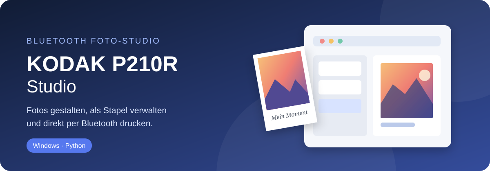
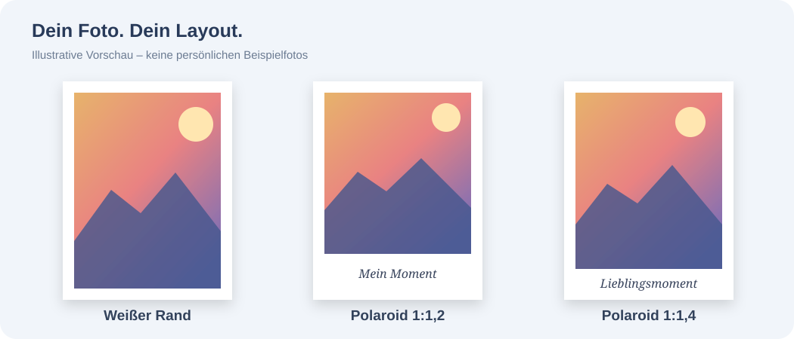
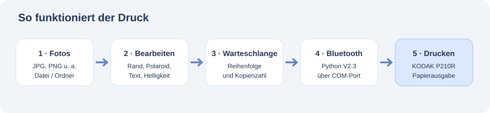

<div align="center">



# KODAK P210R Studio

**Ein kleines Fotostudio für Windows – Bilder bearbeiten, Polaroids gestalten und direkt über Bluetooth auf dem KODAK Mini 2 Retro P210R ausdrucken.**

[Zum Studio](studio/) · [Installation](#installation) · [Drucklayouts](#drucklayouts)

</div>

## Worum geht's?

Ich wollte Fotos vom PC aus auf meinem KODAK Mini 2 Retro drucken, ohne dafür jedes Mal die Smartphone-App zu benutzen. Daraus ist dieses Projekt entstanden: eine Windows-Anwendung, in der man Bilder auswählen, etwas bearbeiten und anschließend einzeln oder als Stapel drucken kann.

Das Ganze ist **vibe-coded**, also mit KI-Unterstützung entwickelt. Die Kommunikation mit dem Drucker basiert auf einer eigenen Untersuchung des Bluetooth-Protokolls. Der erste vollständige Ausdruck über Python hat mit dem Treiber V2.3 funktioniert.

Das Projekt wächst seitdem Stück für Stück. Nicht jede neue Funktion wurde bereits auf jeder Windows-Konfiguration oder mit längeren Druckstapeln ausprobiert.

## Was das Studio kann

- **Fotos auswählen:** Einzelne Bilder oder einen ganzen Ordner laden.
- **Bilder bearbeiten:** Drehen, zuschneiden, zoomen, verschieben und Farben anpassen.
- **Mehr Kontrolle:** Über „Weitere Bearbeitung“ gibt es zusätzliche, Lightroom-inspirierte Regler.
- **Eigene Drucklayouts:** Ohne Rand, mit weißem Rand oder im Polaroid-Stil.
- **Polaroids beschriften:** Eigener Text, verschiedene Schriften oder das Aufnahmedatum aus den EXIF-Daten.
- **Stapel drucken:** Reihenfolge festlegen, Bilder an- und abhaken sowie die Kopienzahl einstellen.
- **Projekte sichern:** Warteschlangen und Einstellungen speichern und später wieder laden.
- **Druckphasen ansehen:** Soweit vom Drucker gemeldet, zeigt das Studio die einzelnen Druckschritte an.

## Drucklayouts



Es gibt einen klassischen **weißen Rahmen** und drei Polaroid-Varianten: **1:1,2**, **1:1,4** und **1:1,6**. Unten bleibt jeweils Platz für eine Beschriftung. Breite und Ausschnitt kannst du anpassen.

Das Papierformat des Druckers ändert sich dabei nicht: Die Anwendung erstellt ein passendes Druckbild mit **640 × 1024 Pixeln**. Auch die Ausrichtung des abtrennbaren Papierstreifens wird in der Vorschau berücksichtigt.

*Die Abbildungen sind Illustrationen, keine Screenshots der Anwendung.*

## Neu in Studio 1.6

Die Oberfläche ist jetzt klar in drei Ansichten aufgeteilt: **Druckwarteschlange**, **Fotogestaltung** und **Druckprotokoll**. So kannst du dich jeweils auf einen Arbeitsschritt konzentrieren, statt alle Bedienelemente gleichzeitig vor dir zu haben. Die Bereiche wechseln über die obere Navigation und klappen nicht wie ein Akkordeon auf und zu.

Die Fotogestaltung hat eine größere Vorschau, zwei Regler zum Feinpositionieren und separat scrollbare Einstellungen. In schmaleren Fenstern rutschen die Einstellungen unter die Vorschau.

Sobald du den Druck startest, öffnet sich die Protokollansicht und zusätzlich ein eigenes Druckfenster. Dort läuft die animierte Farbzone für Gelb, Magenta, Cyan und Schutzschicht **von unten nach oben** über das Foto. Welche Farbe aktiv ist, richtet sich nach den empfangenen Druckerstatusmeldungen. Wie schnell sich die Animation bewegt, ist dagegen nur eine Veranschaulichung und keine gemessene Druckgeschwindigkeit.

## Neu in Studio 1.8: Druckkalibrierung

Über **Hilfe & Links → Druckkalibrierung** kannst du ein mittig platziertes Testquadrat ausdrucken, die vier Papierränder in Millimetern messen und die berechnete Korrektur speichern. Die Korrektur verschiebt das Bild erst bei der Druckausgabe, nicht in der Gestaltung. Das Testquadrat wird absichtlich ohne Korrektur gedruckt, damit eine Nachmessung sinnvoll bleibt. Die Messung sollte am fertigen Foto ohne Abreißstreifen erfolgen.

Außerdem ist die Zuordnung der beobachteten Druckphasen korrigiert: **FF** Druckstart, **05** Vorbereitung, **06** Gelb, **00** Magenta, **01** Cyan, **02** Schutzschicht, **03** abgeschlossen.

Die Kalibrierung ist neu und noch am echten Gerät zu überprüfen. Die 30 Offline-Tests bestehen.

## Installation

Du brauchst **Windows**, **Python 3.10 oder neuer** und einen per Bluetooth gekoppelten **KODAK Mini 2 Retro P210R**.

1. Repository herunterladen oder klonen.
2. Den Ordner `studio` öffnen.
3. `STARTEN.bat` doppelklicken. Beim ersten Start werden die Python-Abhängigkeiten installiert.
4. Den seriellen Bluetooth-COM-Port auswählen. Bei meinem Testgerät war das **COM5**; bei dir kann es ein anderer Port sein.
5. Ein Foto laden, bearbeiten und einen Probedruck starten.

Alternativ über die Eingabeaufforderung:

```bat
cd studio
py -m pip install -r requirements.txt
py app.py
```

**Tipp:** Erst mit einem Foto testen, bevor du eine größere Warteschlange losschickst. Die offizielle KODAK-App sollte währenddessen nicht mit dem Drucker verbunden sein.

## Wie funktioniert der Druck?



Das Studio bearbeitet das Foto lokal und erzeugt daraus die Druckdatei. Anschließend übernimmt der Python-Treiber die Übertragung über den seriellen Bluetooth-Port.

Der Drucker meldet dabei unterschiedliche Phasen. Nach den bisherigen Beobachtungen stehen sie für **Vorbereitung → Gelb → Magenta → Cyan → Schutzschicht → Fertig**. Diese Zuordnung stammt aus Tests mit dem Gerät, nicht aus einer offiziellen Protokolldokumentation.

Die erfolgreiche Druckroutine aus V2.3 dient als Grundlage für das Studio. Änderungen an der Oberfläche und Bildbearbeitung sind davon möglichst getrennt.

## Projektaufbau

```text
kodak/
├── README.md
├── docs/images/          # Illustrationen für diese Seite
└── studio/
    ├── app.py            # Oberfläche und Bildbearbeitung
    ├── driver/           # Bluetooth-Druckroutine
    ├── tests/            # Offline-Tests
    ├── STARTEN.bat       # Start unter Windows
    ├── requirements.txt
    └── README.md         # Weitere technische Hinweise
```

Weitere Details zur Bedienung findest du in der [Studio-README](studio/README.md).

## Stand des Projekts

Der **Einzeldruck per Bluetooth** funktioniert auf dem getesteten P210R. Auch Bildaufbereitung und einige Funktionen rund um die Warteschlange sind durch Offline-Tests abgedeckt. Die neueren Oberflächenfunktionen und größere Druckstapel werden noch weiter getestet.

Wenn bei dir etwas nicht passt, sind besonders Angaben zur Studio-Version, zum Windows-COM-Port und zum Verhalten des Druckers hilfreich.

## Datenschutz und Hinweis

Private Fotos gehören nicht in dieses Repository. Die hier verwendeten Grafiken sind eigens erstellte SVG-Illustrationen; das ursprüngliche Testfoto wurde **nicht** veröffentlicht. Projektdateien können lokale Dateipfade enthalten und sollten ebenfalls privat bleiben.

Dies ist ein **unabhängiges Hobbyprojekt** und keine offizielle KODAK-Software.
